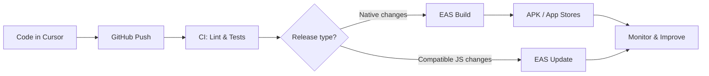

<div align="center">

# Hey there, I'm Anas Ismail 👋

<a href="https://github.com/AnasIsmail8996"></a>

**Full Stack Developer · React Native / Expo · Cloud & DevOps**

📍 Karachi, Pakistan · 🏢 APPOINT DIGITAL Ltd

[](https://github.com/AnasIsmail8996?tab=repositories)
[](https://linkedin.com/in/anas-ismail-ai)
[](mailto:anasismailhz@gmail.com)

**[About](#-about-me) · [Projects](#-featured-project) · [Tech Stack](#-tech-stack) · [DevOps](#-my-devops-workflow) · [Stats](#-github-insights) · [Contact](#-lets-connect)**

</div>

---

## 🚀 About Me

I build production-ready **web and mobile applications** with the MERN stack, **Next.js**, **React Native / Expo**, and modern cloud tooling. I care about clean architecture, fast user experiences, reliable APIs, and repeatable releases.

- 💼 **Current focus:** Full-stack development, Android/iOS apps, CI/CD and cloud delivery at **APPOINT DIGITAL Ltd**
- 🛠️ **I work with:** React, Next.js, TypeScript, Node.js, MongoDB, PostgreSQL and AWS
- 📱 **Mobile:** React Native, Expo, EAS Build and release workflows
- 🎯 **Goal:** Ship scalable products that feel great to use

<details>
<summary><b>👀 Click to see more about my approach</b></summary>
<br>

- **Build:** Accessible interfaces, reusable components and secure APIs
- **Ship:** Version-controlled code, automated checks and reproducible builds
- **Improve:** Monitor errors, optimize performance and iterate from feedback

</details>

## 📱 Featured Project

<a href="https://github.com/AnasIsmail8996/vela"></a>

**Vela** — React Native + Expo mobile app.

[](https://github.com/AnasIsmail8996/vela)
[](https://github.com/AnasIsmail8996?tab=repositories)

<details>
<summary><b>📦 Click to view my mobile release workflow</b></summary>
<br>

```text
Code changes → Git push → CI checks → EAS Build → APK / Store release
                                   ↘ compatible JS updates → EAS Update
```

- **Preview:** Android APK for internal testing
- **Production:** Android AAB / iOS production build for store submission
- **OTA:** Compatible JavaScript and asset updates using EAS Update when configured

</details>

## ⚡ Tech Stack

<details open>
<summary><b>🌐 Frontend & Mobile</b></summary>
<br>


</details>

<details>
<summary><b>🔥 Backend, Database & Realtime</b></summary>
<br>


</details>

<details>
<summary><b>☁️ DevOps, Cloud & Tools</b></summary>
<br>


</details>

## 🔁 My DevOps Workflow



<details>
<summary><b>🛠️ Click to see the pipeline stages</b></summary>
<br>

1. **Develop:** Work in feature branches and review changes.
2. **Integrate:** Run lint, types and tests before merging.
3. **Build:** Create Android or iOS binaries when native dependencies change.
4. **Deliver:** Distribute preview builds or submit production builds for review.
5. **Observe:** Investigate crashes and performance regressions.

</details>

## 📈 GitHub Insights

<div align="center">
  
  
  <br>
  
</div>

> Note: These cards depend on third-party services and may occasionally be unavailable.

## 💼 Professional Journey

<details>
<summary><b>🏢 APPOINT DIGITAL Ltd — Full Stack Developer / DevOps</b></summary>
<br>

- Building full-stack MERN web and React Native apps
- Designing REST APIs, authentication and real-time features
- Working with Docker, CI/CD, Nginx and AWS infrastructure
- Optimizing app reliability, performance and architecture

</details>

<details>
<summary><b>🎓 SMIT / Techzify Bootcamp — Full Stack Trainee (2022–2026)</b></summary>
<br>

- JavaScript, React, Node.js, Express and databases
- E-commerce projects, dashboards and authentication systems
- Git workflows, API integration and deployment foundations

</details>

## 🤝 Let's Connect

<div align="center">

[](https://linkedin.com/in/anas-ismail-ai)
[](mailto:anasismailhz@gmail.com)
[](https://github.com/AnasIsmail8996)

**⭐ Code. Learn. Build. Deploy. Repeat. 🚀**

[⬆ Back to Top](#hey-there-im-anas-ismail-)

</div>
